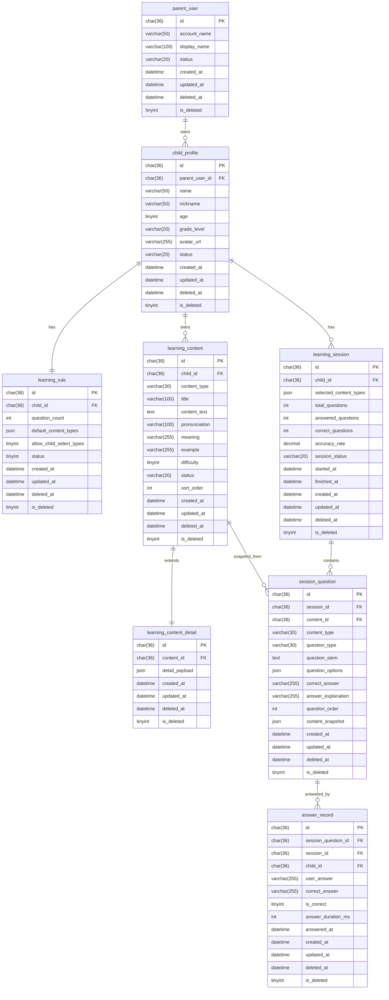

# 儿童学习助手数据库设计文档

## 1. 文档说明

- 文档名称：数据库设计文档
- 版本：V1.0
- 日期：2026-08-20
- 适用范围：儿童学习助手 MVP
- 设计依据：产品需求文档、技术架构设计文档

说明：

- 本项目运行时存储介质为 JSON 文件，不使用传统关系型数据库。
- 为了保证领域模型清晰、便于后续迁移到真实数据库，本文档采用“逻辑表结构设计”的方式描述实体、字段、索引和约束。
- 所有表均统一考虑主键、软删除、创建时间、更新时间和必要的业务约束。

## 2. 设计原则

- 贴合当前业务闭环：孩子档案、学习内容、学习规则、学习会话、题目快照、作答记录
- 优先使用清晰稳定的主实体，避免过早拆分过细
- 支持软删除，避免影响历史学习记录追溯
- 历史会话与题目必须快照化保存，防止内容编辑影响已完成记录
- 字段类型尽量贴近未来关系型数据库迁移场景

## 3. 核心实体清单

- `parent_user`：家长账户
- `child_profile`：孩子档案
- `learning_rule`：学习规则
- `math_settings`：算术设置（每孩子一条，含范围与运算符）
- `learning_content`：学习内容主表
- `learning_content_detail`：学习内容扩展明细表
- `learning_session`：学习会话
- `session_question`：会话题目快照
- `answer_record`：题目作答记录

## 4. 实体关系图

## 5. 表设计

## 5.1 parent_user

用途：保存家长账户信息。MVP 即使不做完整登录体系，也建议保留此实体，便于后续多孩子、多账户隔离。

| 字段名       | 类型         | 可空 | 默认值 | 说明                   |
| ------------ | ------------ | ---- | ------ | ---------------------- |
| id           | char(36)     | 否   | UUID   | 主键                   |
| account_name | varchar(50)  | 否   | 无     | 家长账号标识，建议唯一 |
| display_name | varchar(100) | 否   | 无     | 家长显示名称           |
| status       | varchar(20)  | 否   | active | 状态：active、disabled |
| created_at   | datetime     | 否   | now    | 创建时间               |
| updated_at   | datetime     | 否   | now    | 更新时间               |
| deleted_at   | datetime     | 是   | null   | 软删除时间             |
| is_deleted   | tinyint      | 否   | 0      | 软删除标记             |

索引建议：

- 主键索引：`pk_parent_user(id)`
- 唯一索引：`uk_parent_user_account_name(account_name)`
- 普通索引：`idx_parent_user_status(status)`

约束建议：

- `account_name` 全局唯一
- `is_deleted` 仅允许 0 或 1
- `status` 仅允许 active、disabled

## 5.2 child_profile

用途：保存孩子档案，是学习内容、学习规则、学习会话的业务归属主体。

| 字段名         | 类型         | 可空 | 默认值 | 说明                |
| -------------- | ------------ | ---- | ------ | ------------------- |
| id             | char(36)     | 否   | UUID   | 主键                |
| parent_user_id | char(36)     | 否   | 无     | 关联家长账户        |
| name           | varchar(50)  | 否   | 无     | 孩子姓名            |
| nickname       | varchar(50)  | 是   | null   | 昵称                |
| age            | tinyint      | 否   | 无     | 年龄，建议范围 3-12 |
| grade_level    | varchar(20)  | 是   | null   | 年级或学段          |
| avatar_url     | varchar(255) | 是   | null   | 头像地址            |
| status         | varchar(20)  | 否   | active | 状态                |
| created_at     | datetime     | 否   | now    | 创建时间            |
| updated_at     | datetime     | 否   | now    | 更新时间            |
| deleted_at     | datetime     | 是   | null   | 软删除时间          |
| is_deleted     | tinyint      | 否   | 0      | 软删除标记          |

索引建议：

- 主键索引：`pk_child_profile(id)`
- 普通索引：`idx_child_profile_parent_user_id(parent_user_id)`
- 组合索引：`idx_child_profile_parent_status(parent_user_id, status)`

约束建议：

- `parent_user_id` 必须引用有效家长
- `age` 范围建议限制在 3-12
- `is_deleted` 为 1 时，`status` 不再作为业务有效状态使用

## 5.3 learning_rule

用途：保存每个孩子的默认学习规则。

| 字段名                   | 类型     | 可空 | 默认值 | 说明                   |
| ------------------------ | -------- | ---- | ------ | ---------------------- |
| id                       | char(36) | 否   | UUID   | 主键                   |
| child_id                 | char(36) | 否   | 无     | 关联孩子               |
| question_count           | int      | 否   | 5      | 每轮题量               |
| default_content_types    | json     | 否   | []     | 默认参与抽题的内容类型 |
| allow_child_select_types | tinyint  | 否   | 1      | 是否允许孩子选择类型   |
| status                   | tinyint  | 否   | 1      | 是否启用规则           |
| created_at               | datetime | 否   | now    | 创建时间               |
| updated_at               | datetime | 否   | now    | 更新时间               |
| deleted_at               | datetime | 是   | null   | 软删除时间             |
| is_deleted               | tinyint  | 否   | 0      | 软删除标记             |

索引建议：

- 主键索引：`pk_learning_rule(id)`
- 唯一索引：`uk_learning_rule_child_id(child_id)`

约束建议：

- 一个孩子仅允许一条有效规则
- `question_count` 建议范围 1-20
- `allow_child_select_types` 仅允许 0、1
- `status` 仅允许 0、1

## 5.4 learning_content

用途：保存五类学习内容的共性字段，是内容管理和题目生成的主数据来源。

| 字段名        | 类型         | 可空 | 默认值  | 说明                    |
| ------------- | ------------ | ---- | ------- | ----------------------- |
| id            | char(36)     | 否   | UUID    | 主键                    |
| child_id      | char(36)     | 否   | 无      | 关联孩子                |
| content_type  | varchar(30)  | 否   | 无      | 内容类型                |
| title         | varchar(100) | 否   | 无      | 标题或主展示名称        |
| content_text  | text         | 否   | 无      | 内容正文                |
| pronunciation | varchar(100) | 是   | null    | 拼音、音标或发音        |
| meaning       | varchar(255) | 是   | null    | 释义                    |
| example       | varchar(255) | 是   | null    | 示例                    |
| difficulty    | tinyint      | 否   | 1       | 难度级别 1-3            |
| status        | varchar(20)  | 否   | enabled | 状态：enabled、disabled |
| sort_order    | int          | 否   | 0       | 排序值                  |
| created_at    | datetime     | 否   | now     | 创建时间                |
| updated_at    | datetime     | 否   | now     | 更新时间                |
| deleted_at    | datetime     | 是   | null    | 软删除时间              |
| is_deleted    | tinyint      | 否   | 0       | 软删除标记              |

索引建议：

- 主键索引：`pk_learning_content(id)`
- 普通索引：`idx_learning_content_child_id(child_id)`
- 组合索引：`idx_learning_content_child_type_status(child_id, content_type, status)`
- 组合索引：`idx_learning_content_child_deleted(child_id, is_deleted)`

约束建议：

- `content_type` 仅允许：character、classic、poem、idiom、englishWord、pinyin、math（其中 `math`、`pinyin` 为虚拟类型，无具体内容条目，仅用于会话类型选择，题目分别由 `math_settings`、`pinyin_settings` 即时生成）
- `difficulty` 仅允许：1、2、3
- `status` 仅允许：enabled、disabled
- `title` 不允许为空字符串

## 5.5 learning_content_detail

用途：保存不同学习内容类型的扩展字段，避免主表字段过多且高度稀疏。

说明：

- 该表使用 `detail_payload` 承载类型专属字段。
- 若未来迁移到关系型数据库且查询复杂度提升，可进一步拆分为 `character_content_detail`、`poem_content_detail` 等专属表。

| 字段名         | 类型     | 可空 | 默认值 | 说明         |
| -------------- | -------- | ---- | ------ | ------------ |
| id             | char(36) | 否   | UUID   | 主键         |
| content_id     | char(36) | 否   | 无     | 关联学习内容 |
| detail_payload | json     | 否   | {}     | 类型扩展字段 |
| created_at     | datetime | 否   | now    | 创建时间     |
| updated_at     | datetime | 否   | now    | 更新时间     |
| deleted_at     | datetime | 是   | null   | 软删除时间   |
| is_deleted     | tinyint  | 否   | 0      | 软删除标记   |

索引建议：

- 主键索引：`pk_learning_content_detail(id)`
- 唯一索引：`uk_learning_content_detail_content_id(content_id)`

约束建议：

- 一条学习内容仅允许一条有效扩展记录
- `detail_payload` 必须符合对应 `content_type` 的 schema

扩展字段建议：

- 汉字：`character`、`pinyin`、`word_example`
- 国学：`source_title`、`sentence_text`、`sentence_meaning`、`next_sentence`、`previous_sentence`
- 古诗：`poem_title`、`author`、`dynasty`、`poem_lines`、`poem_meaning`
- 成语：`idiom_text`、`pinyin`、`story`、`usage_example`
- 英语：`word`、`phonetic`、`chinese_meaning`、`part_of_speech`、`example_sentence`

## 5.6 learning_session

用途：保存一轮学习的会话级汇总数据。

| 字段名                 | 类型         | 可空 | 默认值      | 说明                               |
| ---------------------- | ------------ | ---- | ----------- | ---------------------------------- |
| id                     | char(36)     | 否   | UUID        | 主键                               |
| child_id               | char(36)     | 否   | 无          | 关联孩子                           |
| selected_content_types | json         | 否   | []          | 孩子本轮选择的内容类型，可为空数组 |
| total_questions        | int          | 否   | 0           | 本轮题目总数                       |
| answered_questions     | int          | 否   | 0           | 已作答题数                         |
| correct_questions      | int          | 否   | 0           | 正确题数                           |
| accuracy_rate          | decimal(5,2) | 否   | 0.00        | 正确率，百分比或小数都可，需统一   |
| session_status         | varchar(20)  | 否   | in_progress | 会话状态                           |
| started_at             | datetime     | 否   | now         | 开始时间                           |
| finished_at            | datetime     | 是   | null        | 完成时间                           |
| created_at             | datetime     | 否   | now         | 创建时间                           |
| updated_at             | datetime     | 否   | now         | 更新时间                           |
| deleted_at             | datetime     | 是   | null        | 软删除时间                         |
| is_deleted             | tinyint      | 否   | 0           | 软删除标记                         |

索引建议：

- 主键索引：`pk_learning_session(id)`
- 普通索引：`idx_learning_session_child_id(child_id)`
- 组合索引：`idx_learning_session_child_status(child_id, session_status)`
- 组合索引：`idx_learning_session_child_started_at(child_id, started_at)`

约束建议：

- `session_status` 仅允许：in_progress、completed、abandoned
- `correct_questions <= answered_questions <= total_questions`
- 已完成会话必须有 `finished_at`

## 5.7 session_question

用途：保存某次学习会话中的题目快照，保证会话历史稳定可回放。

| 字段名             | 类型         | 可空 | 默认值 | 说明                |
| ------------------ | ------------ | ---- | ------ | ------------------- |
| id                 | char(36)     | 否   | UUID   | 主键                |
| session_id         | char(36)     | 否   | 无     | 关联学习会话        |
| content_id         | char(36)     | 否   | 无     | 来源学习内容        |
| content_type       | varchar(30)  | 否   | 无     | 内容类型            |
| question_type      | varchar(30)  | 否   | 无     | 题型                |
| question_stem      | text         | 否   | 无     | 题干                |
| question_options   | json         | 是   | null   | 选项数组            |
| correct_answer     | varchar(255) | 否   | 无     | 正确答案            |
| answer_explanation | varchar(255) | 是   | null   | 答案解释            |
| question_order     | int          | 否   | 无     | 题目顺序，从 1 开始 |
| content_snapshot   | json         | 否   | {}     | 内容快照            |
| created_at         | datetime     | 否   | now    | 创建时间            |
| updated_at         | datetime     | 否   | now    | 更新时间            |
| deleted_at         | datetime     | 是   | null   | 软删除时间          |
| is_deleted         | tinyint      | 否   | 0      | 软删除标记          |

索引建议：

- 主键索引：`pk_session_question(id)`
- 普通索引：`idx_session_question_session_id(session_id)`
- 组合唯一索引：`uk_session_question_session_order(session_id, question_order)`
- 组合索引：`idx_session_question_content_id(content_id, content_type)`

约束建议：

- `question_order` 在同一会话内唯一
- `content_type` 必须与来源内容一致
- `question_type` 仅允许当前模板支持的类型值

## 5.8 answer_record

用途：保存孩子对每道题的作答记录。

| 字段名              | 类型         | 可空 | 默认值 | 说明           |
| ------------------- | ------------ | ---- | ------ | -------------- |
| id                  | char(36)     | 否   | UUID   | 主键           |
| session_question_id | char(36)     | 否   | 无     | 关联会话题目   |
| session_id          | char(36)     | 否   | 无     | 关联学习会话   |
| child_id            | char(36)     | 否   | 无     | 关联孩子       |
| user_answer         | varchar(255) | 是   | null   | 用户作答       |
| correct_answer      | varchar(255) | 否   | 无     | 正确答案快照   |
| is_correct          | tinyint      | 否   | 0      | 是否答对       |
| answer_duration_ms  | int          | 是   | null   | 作答耗时，毫秒 |
| answered_at         | datetime     | 否   | now    | 作答时间       |
| created_at          | datetime     | 否   | now    | 创建时间       |
| updated_at          | datetime     | 否   | now    | 更新时间       |
| deleted_at          | datetime     | 是   | null   | 软删除时间     |
| is_deleted          | tinyint      | 否   | 0      | 软删除标记     |

索引建议：

- 主键索引：`pk_answer_record(id)`
- 普通索引：`idx_answer_record_session_id(session_id)`
- 普通索引：`idx_answer_record_child_id(child_id)`
- 唯一索引：`uk_answer_record_session_question_id(session_question_id)`
- 组合索引：`idx_answer_record_child_answered_at(child_id, answered_at)`

约束建议：

- 每道会话题目仅允许一条最终作答记录
- `is_correct` 仅允许 0、1
- `answer_duration_ms >= 0`

## 6. 软删除设计

所有表统一采用软删除设计。

统一字段：

- `is_deleted`：0 表示未删除，1 表示已删除
- `deleted_at`：删除时间

统一规则：

- 默认查询必须过滤 `is_deleted = 0`
- 业务删除优先软删除
- 学习内容、孩子档案等核心主体被删除后，不影响历史学习会话和作答记录查询

## 7. 通用字段规范

建议所有表统一保留以下字段：

- `id`
- `created_at`
- `updated_at`
- `deleted_at`
- `is_deleted`

时间字段规范：

- 使用 UTC 时间存储
- 接口层按前端时区转换展示
- `updated_at` 在每次写入时必须更新

## 8. 关键约束汇总

- 一个家长可拥有多个孩子
- 一个孩子仅有一条有效学习规则
- 一个孩子可拥有多条学习内容
- 一条学习内容对应一条扩展明细
- 一次学习会话可包含多道题目
- 一道会话题目仅对应一条最终作答记录
- 历史会话和作答记录必须依赖快照，不受原始内容后续修改影响

## 9. 索引策略汇总

高频查询场景：

- 按孩子查询内容列表
- 按孩子与类型查询可用学习内容
- 按孩子查询最近学习记录
- 按会话查询题目列表
- 按孩子查询答题历史和统计

推荐重点索引：

- `learning_content(child_id, content_type, status)`
- `learning_session(child_id, started_at)`
- `answer_record(child_id, answered_at)`
- `session_question(session_id, question_order)`

## 10. 逻辑表与 JSON 存储映射说明

由于当前技术架构使用 JSON 文件存储，逻辑表在物理层不会一一对应真实数据库表，而会映射为 JSON 数据集合。推荐映射如下：

- `parent_user` -> `data/parent_users.json`
- `child_profile` -> `data/children.json`
- `learning_rule` -> `data/learning_rules.json`
- `learning_content` + `learning_content_detail` -> `data/contents/*.json`
- `learning_session` -> `data/sessions/learning_sessions.json`
- `session_question` -> `data/sessions/session_questions.json`
- `answer_record` -> `data/sessions/answer_records.json`

## 11. 结论

本数据库设计方案兼顾了当前 JSON 文件存储约束和未来数据库迁移的可演进性。

设计重点包括：

- 以孩子为核心归属主体组织全部业务数据
- 以学习内容主表加扩展明细表承载多内容类型差异
- 以学习会话、会话题目、作答记录组成完整学习轨迹
- 统一采用软删除与时间字段规范
- 通过快照模型保证历史数据稳定性

该方案适合当前 MVP 阶段，也为后续迁移到 MySQL、PostgreSQL 等真实数据库提供了直接参考。
