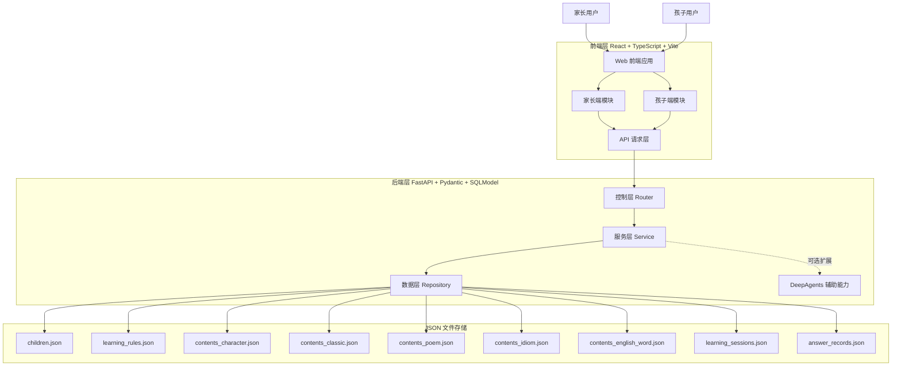
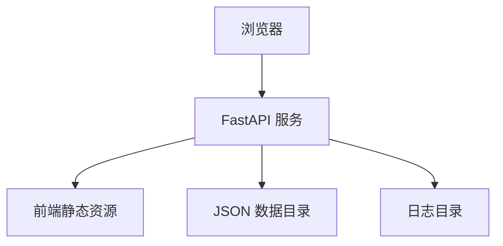

# 儿童学习助手技术架构设计文档

## 1. 文档信息

- 项目名称：儿童学习助手
- 文档版本：V1.0
- 文档日期：2026-08-20
- 对应需求文档：PRD-儿童学习产品.md
- 文档目标：基于产品需求文档，输出首版 MVP 的技术架构方案，用于指导前后端研发、联调、部署和后续演进

## 2. 架构目标

本项目首版需要支持家长端录入学习内容、孩子端开始学习与答题、系统随机抽题并生成题目、家长端查看学习结果的完整闭环。

在技术实现上，架构目标如下：

- 满足首版 Web 端双角色产品交互需求
- 满足模板化出题、非开放式 AI 生成的核心要求
- 使用 JSON 文件完成数据持久化，避免引入额外数据库依赖
- 控制实现复杂度，保证 MVP 可以快速开发和稳定交付
- 为后续升级到更强存储能力和智能能力预留扩展边界

## 3. 技术栈约束

### 3.1 前端技术栈

- React
- TypeScript
- Vite
- Ant Design
- Tailwind CSS

### 3.2 后端技术栈

- FastAPI
- DeepAgents
- Pydantic
- SQLModel
- Python 3.12

### 3.3 数据存储约束

- 不使用关系型数据库或 NoSQL 数据库
- 所有持久化数据使用 JSON 文件保存

## 4. 整体架构设计

系统采用前后端分离架构，前端负责家长端与孩子端交互，后端负责业务规则处理、题目生成、学习记录、统计分析与 JSON 文件读写。

首版采用单体后端服务模式，避免在 JSON 文件存储条件下引入过高的分布式复杂度。

### 4.1 整体架构图



### 4.2 架构说明

- 前端为单一 Web 工程，在逻辑上拆分家长端和孩子端模块
- 后端为单一 FastAPI 服务，负责全部业务逻辑处理
- 数据以 JSON 文件形式保存在本地持久化目录
- DeepAgents 在首版中不进入核心出题链路，仅作为后续可扩展辅助能力保留接入边界

## 5. 分层架构说明

后端采用典型三层结构：控制层、服务层、数据层。

### 5.1 控制层

控制层由 FastAPI Router 组成。

职责：

- 提供 RESTful API
- 接收并解析前端请求
- 调用 Pydantic Schema 完成请求参数校验
- 统一响应结构和错误处理
- 调用服务层执行业务逻辑

控制层不负责：

- 题目生成逻辑
- 抽题逻辑
- 统计逻辑
- 文件读写逻辑

建议接口分组：

- `/api/children`
- `/api/contents`
- `/api/rules`
- `/api/sessions`
- `/api/stats`

### 5.2 服务层

服务层是系统核心，负责承载产品业务规则。

建议服务拆分：

- `ChildService`
  - 负责孩子档案创建、查询、修改
- `ContentService`
  - 负责五类学习内容的新增、编辑、删除、启用、停用、查询
- `RuleService`
  - 负责学习规则设置与查询
- `QuestionGenerationService`
  - 负责根据学习内容模板生成题目
- `LearningSessionService`
  - 负责生成学习会话、随机抽题、保存答题过程和学习结果
- `StatsService`
  - 负责学习记录聚合统计与薄弱项分析
- `AgentAssistService`
  - 负责封装 DeepAgents 相关可选辅助能力

服务层职责：

- 实现内容类型差异化规则
- 实现随机抽题规则
- 实现题目模板映射规则
- 实现正确答案判定
- 实现学习结果记录和统计
- 保证历史学习数据可回放、可追踪

### 5.3 数据层

数据层通过 Repository 统一封装 JSON 文件读写。

职责：

- 读取指定 JSON 文件
- 将文件内容转换为结构化对象
- 写入更新后的 JSON 内容
- 提供基础 CRUD 操作
- 提供文件级锁与原子写保护

建议仓储拆分：

- `ChildRepository`
- `RuleRepository`
- `ContentRepository`
- `LearningSessionRepository`
- `AnswerRecordRepository`
- `JsonStore`

数据层设计原则：

- 文件结构清晰、边界稳定
- 不在数据层写业务逻辑
- 通过统一底层组件处理 JSON 文件序列化和原子替换写入

## 6. 核心模块设计

### 6.1 家长端模块

负责面向家长的配置与查看能力。

模块范围：

- 孩子档案管理
- 学习内容管理
- 学习规则设置
- 学习记录与结果查看

技术侧重点：

- 表单驱动
- 列表查询与筛选
- 内容类型动态表单渲染
- 基础统计卡片展示

### 6.2 孩子端模块

负责孩子的学习流程与答题交互。

模块范围：

- 学习类型选择
- 开始学习
- 单题答题
- 即时反馈
- 结果页

技术侧重点：

- 大按钮与少文字交互
- 一次一题的轻量化页面流
- 状态清晰的会话流程管理

### 6.3 题目生成模块

题目生成采用模板驱动，不使用开放式 AI 生成。

设计原则：

- 根据内容类型映射固定题型
- 优先选择题、补全题、排序题
- 干扰项优先从同类型内容中生成
- 若干扰项不足，允许减少选项数，不强行生成低质量选项

### 6.4 学习会话模块

负责串联一次完整学习过程。

流程包括：

1. 接收孩子当前的分类选择
2. 读取学习规则
3. 筛选已启用内容
4. 随机抽取学习项
5. 生成题目快照
6. 返回题目列表或首题
7. 保存答题记录
8. 生成学习结果汇总

### 6.5 统计分析模块

负责面向家长端输出可读统计信息。

统计范围：

- 总学习次数
- 最近学习次数
- 平均正确率
- 各内容类型正确率
- 薄弱内容项

## 7. JSON 数据存储方案

### 7.1 存储策略

由于数据库固定为 JSON 文件，需避免单文件过大和全量频繁重写问题，因此建议按实体和内容类型拆分存储。

建议目录结构：

```text
data/
  children.json
  learning_rules.json
  contents/
    character.json
    classic.json
    poem.json
    idiom.json
    english_word.json
  sessions/
    learning_sessions.json
    answer_records.json
```

### 7.2 文件边界说明

- `children.json`：保存孩子档案
- `learning_rules.json`：保存孩子学习规则
- `contents/*.json`：按内容类型分别保存学习内容
- `learning_sessions.json`：保存每次学习会话摘要
- `answer_records.json`：保存每道题的作答明细

### 7.3 数据一致性策略

- 使用 UUID 作为主键
- 每条记录包含 `createdAt` 和 `updatedAt`
- 建议增加 `schemaVersion`
- 删除优先采用停用，而不是物理删除
- 历史会话需保存题目快照，防止后续内容修改影响已完成记录

### 7.4 文件写入策略

- 采用临时文件写入后原子替换
- 同一文件只允许串行写入
- 可对读取内容进行轻量缓存，写入后立即失效

## 8. 前端技术架构说明

### 8.1 架构设计思路

前端采用单页应用，逻辑上分为家长端和孩子端，但在一个 React 工程内完成。

设计原则：

- API 调用统一收口
- 业务模块按领域拆分
- 管理端与学习端采用不同 UI 风格实现

### 8.2 Ant Design 与 Tailwind CSS 的使用策略

- 家长端：优先使用 Ant Design
- 孩子端：优先使用 Tailwind CSS 进行定制化界面开发
- 公共基础样式：由 Tailwind 管理
- 管理类复杂组件：由 Ant Design 提供

该组合的原因是：

- 家长端偏后台管理风格，Ant Design 可提升开发效率
- 孩子端需要更自由的视觉和交互控制，Tailwind 更灵活

## 9. 后端技术架构说明

### 9.1 FastAPI 的角色

FastAPI 负责：

- 提供接口服务
- 管理请求生命周期
- 提供自动接口文档
- 与 Pydantic 模型协同完成输入输出校验

### 9.2 Pydantic 的角色

Pydantic 负责：

- 请求参数校验
- 响应结构校验
- JSON 文件加载后的数据校验
- 各类学习内容的字段结构约束

### 9.3 SQLModel 的角色

在本项目中，SQLModel 不用于关系型数据库访问，而是作为结构化领域模型使用。

作用包括：

- 统一定义领域对象
- 保持模型字段描述一致性
- 便于未来迁移到数据库架构

### 9.4 DeepAgents 的角色

DeepAgents 在本项目中的定位是可选辅助能力，而不是核心学习引擎。

首版建议：

- 不接入孩子端题目生成主流程
- 不用于开放式题目或答案判定
- 仅保留后续扩展接口，例如：
  - 家长录入内容质量提示
  - 内容字段补全建议
  - 学习结果自然语言总结

## 10. 目录结构约定

### 10.1 前端目录结构

```text
frontend/
  src/
    app/
      router.tsx
      providers.tsx
      store.ts
    api/
      client.ts
      children.ts
      contents.ts
      rules.ts
      sessions.ts
      stats.ts
    features/
      parent/
        pages/
        components/
        hooks/
      child/
        pages/
        components/
        hooks/
      learning/
        components/
        hooks/
        types.ts
      stats/
        pages/
        components/
    components/
      common/
      layout/
    styles/
      index.css
      tailwind.css
    types/
      api.ts
      domain.ts
    utils/
```

### 10.2 后端目录结构

```text
backend/
  app/
    main.py
    api/
      deps.py
      routers/
        children.py
        contents.py
        rules.py
        sessions.py
        stats.py
    core/
      config.py
      errors.py
      locking.py
      logging.py
    models/
      child.py
      content.py
      question.py
      rule.py
      session.py
    schemas/
      children.py
      contents.py
      rules.py
      sessions.py
      stats.py
    services/
      agent_assist_service.py
      child_service.py
      content_service.py
      learning_session_service.py
      question_generation_service.py
      rule_service.py
      stats_service.py
    repositories/
      answer_record_repository.py
      child_repository.py
      content_repository.py
      json_store.py
      learning_session_repository.py
      rule_repository.py
    agents/
      content_assistant.py
  data/
    children.json
    learning_rules.json
    contents/
    sessions/
  tests/
```

## 11. 第三方依赖选型理由

### 11.1 前端依赖选型理由

#### React

- 组件化能力强
- 适合家长端和孩子端在同一工程下复用公共逻辑
- 生态成熟，便于后续扩展

#### TypeScript

- 强类型约束能降低前后端联调错误
- 适合管理多内容类型、多接口返回结构

#### Vite

- 启动快，构建快
- 配置简单，适合 MVP 项目

#### Ant Design

- 表单、表格、筛选、弹窗、卡片组件完善
- 适合家长端管理类界面快速搭建

#### Tailwind CSS

- 样式表达灵活
- 适合孩子端按钮、卡片、流程页等定制化界面
- 有利于快速实现响应式布局

### 11.2 后端依赖选型理由

#### FastAPI

- API 开发效率高
- 自动文档能力强
- 类型提示和异步支持完善

#### Pydantic

- 结构校验能力强
- 对 JSON 文件场景特别适合
- 可统一请求、响应和存储校验

#### SQLModel

- 数据模型表达清晰
- 与 Pydantic 风格一致
- 有助于未来从 JSON 存储迁移到数据库

#### DeepAgents

- 满足指定技术栈要求
- 适合作为后续智能辅助能力扩展点
- 不干扰首版核心稳定链路

## 12. 部署方案

### 12.1 MVP 部署原则

- 尽量单体部署
- 尽量减少运行组件数量
- 确保 JSON 文件有稳定持久化目录
- 避免多实例并发写入

### 12.2 推荐部署方式

推荐采用单机部署：

- 前端使用 Vite 构建静态资源
- 后端使用 FastAPI 提供 API 和可选静态资源托管
- JSON 文件位于服务端本地持久化目录

### 12.3 部署拓扑图



### 12.4 运行建议

- 使用单个 Uvicorn 进程运行后端
- 使用环境变量指定数据目录
- 开启基本访问日志和错误日志
- 定期备份 `data/` 目录

### 12.5 后续演进路径

当项目进入下一阶段，若数据量和并发增长，可按如下方向演进：

1. 将 JSON 存储迁移为数据库
2. 将统计模块与主业务逻辑解耦
3. 引入任务队列处理耗时统计或内容分析
4. 将 DeepAgents 逐步用于受控辅助功能

## 13. 风险点与约束

### 13.1 数据并发风险

风险：

- JSON 文件没有事务能力
- 家长修改内容与孩子答题记录同时写入时，存在覆盖风险

应对策略：

- 首版采用单进程部署
- 使用文件级串行锁
- 使用原子替换写入

### 13.2 数据一致性风险

风险：

- 内容修改后，历史学习记录可能不一致
- 物理删除内容可能导致历史数据不可追溯

应对策略：

- 保存题目快照
- 内容优先停用，不直接删除
- 历史记录永远基于当时快照展示

### 13.3 题目生成质量风险

风险：

- 家长输入内容质量直接影响题目质量
- 可用干扰项不足时，题目体验会下降

应对策略：

- 强制结构化录入
- 每类内容定义必填字段
- 选项不足时允许退化为较少选项

### 13.4 性能风险

风险：

- 学习开始时需要快速完成抽题与题目生成
- JSON 文件增长后可能影响读取性能

应对策略：

- 文件分类型拆分
- 轻量缓存内容数据
- 答题记录独立存储

### 13.5 AI 边界风险

风险：

- 若直接使用 AI 生成儿童题目，稳定性和准确率不可控

应对策略：

- MVP 阶段 DeepAgents 不进入核心出题链路
- 所有孩子端题目仍由模板服务生成

### 13.6 架构约束总结

- 当前方案适用于 MVP 和低并发阶段
- 不适合多实例横向扩展
- 不适合高频写入场景
- 若未来用户量增长，需要优先替换底层存储方案

## 14. 结论

本技术架构方案围绕“低复杂度、强可控、快速交付”的目标设计，符合当前产品 PRD 和固定技术栈约束。

其核心特点是：

- 前端采用 React 单工程承载家长端与孩子端
- 后端采用 FastAPI 单体服务承载全部核心业务逻辑
- 数据通过 JSON 文件持久化，按实体和内容类型拆分
- 核心学习链路采用模板化题目生成，避免开放式 AI 风险
- DeepAgents 保留为后续辅助能力扩展点，而不是核心执行引擎

该架构可以支持首版 MVP 快速启动，并为后续数据库迁移、统计能力增强和智能能力引入保留了清晰演进路径。